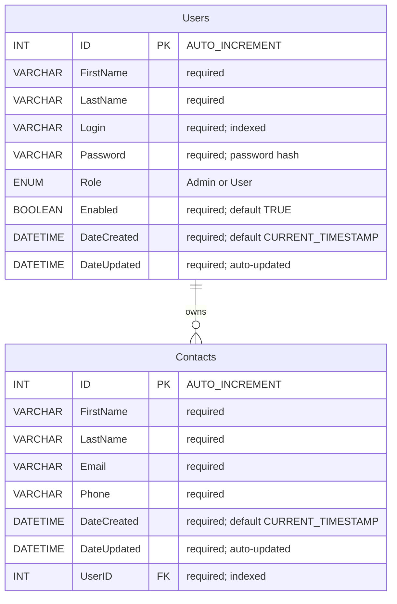

# ContactsAppDB Entity Relationship Diagram

This diagram describes the application-aligned schema for the Contact Manager website.
The canonical definition is `database/create_tables.sql`, cross-checked against the SQL queries in `apifiles/index.php` and `apifiles/config/helpers.php`.

## Relationship

- One `Users` row may own zero or more `Contacts` rows.
- Every `Contacts` row must belong to exactly one `Users` row through `Contacts.UserID` -> `Users.ID`.
- The foreign key `fk_contacts_userid` uses `ON DELETE CASCADE` and `ON UPDATE CASCADE`.
  Deleting a user therefore deletes that user's contacts automatically.

## Constraints And Indexes

| Table | Constraint or index | Definition |
| --- | --- | --- |
| `Users` | Primary key | `ID` |
| `Users` | Index | `idx_users_login` on `Login` |
| `Contacts` | Primary key | `ID` |
| `Contacts` | Index | `idx_contacts_userid` on `UserID` |
| `Contacts` | Foreign key | `fk_contacts_userid`: `UserID` references `Users(ID)` |

`Login` is indexed for authentication and duplicate-login checks in the API. The current SQL does not declare it `UNIQUE`; the registration and admin-create endpoints enforce uniqueness by checking before insert.

## Application Usage

- Authentication, registration, admin account creation, status changes, and password changes operate on `Users`.
- Contact search, creation, update, and deletion operate on `Contacts` and scope records by the authenticated user's `UserID`.
- Admin user listings load each user's related contacts through `Contacts.UserID`.
- `Role` is an enum attribute on `Users`, not a separate entity. It controls whether an account has admin access.
- The database account `ContactsAppUser` is a MySQL connection principal, not an application entity and is not included in the ERD.

## Schema Drift Note

`database/resetdb.sql` recreates the `Users` table without the `Role` and `Enabled` columns, even though `database/create_tables.sql`, the API, and the frontend depend on both columns. Running that reset script as written can leave the application unable to authenticate or create accounts correctly. It should be updated to match `create_tables.sql` before being treated as the canonical reset schema.
